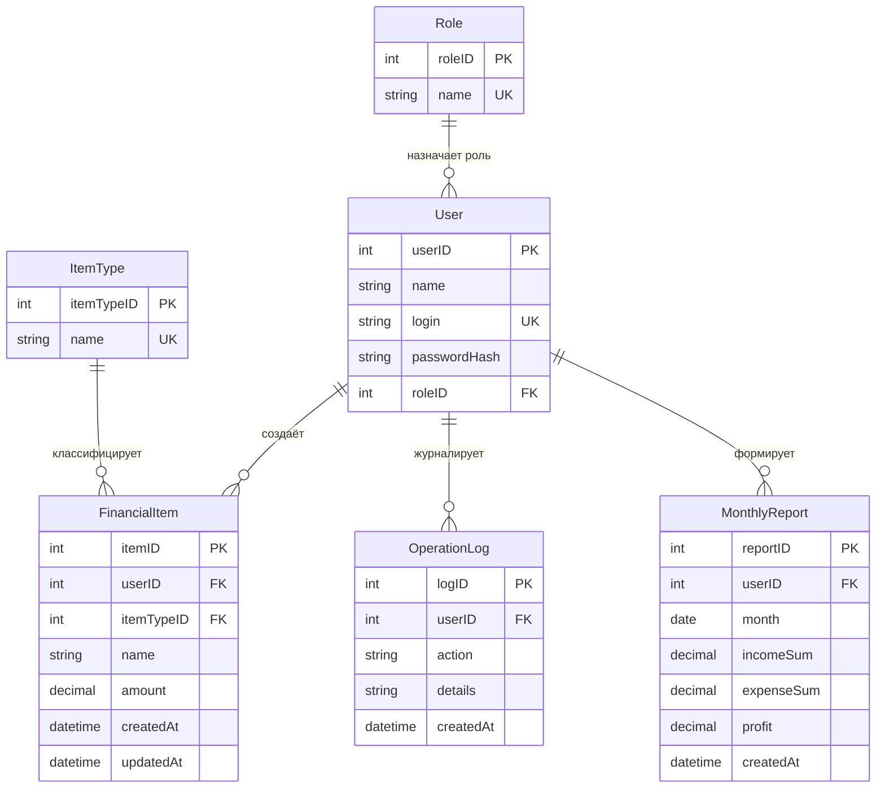

# MoneyOrgTrack

Система контроля доходов и расходов организации. Она помогает руководству отслеживать финансы компании, а сотрудникам — просматривать денежные потоки, не имея возможности их изменить.

## 1. Постановка задачи

**Предметная область:** финансовые операции организации — пункты доходов и расходов, суммы, даты, описания, пользователи системы и их роли.

**Цели системы:**

- централизованно хранить данные о доходах и расходах;
- разграничивать доступ по ролям;
- рассчитывать доходы, расходы и прибыль за выбранный месяц;
- экспортировать данные в распространённые форматы.

**Пользователи (акторы):**

| Роль | Возможности |
| --- | --- |
| Администратор (`admin`) | Всё, что может руководитель, плюс управление пользователями |
| Руководитель (`manager`) | Изменение категорий и операций, отчёты, экспорт |
| Сотрудник (`employee`) | Только просмотр операций, отчётов и экспорт |

**Основные функции:** просмотр списка доходов и расходов, добавление/удаление пунктов доходов и расходов, изменение сумм, расчёт доходов за месяц, сохранение изменений, регистрация и авторизация, экспорт данных.

**Архитектура:** многослойная (Presentation → Business Logic → Data Access → Database). Реализована на Python 3.10+ с использованием только стандартной библиотеки (`sqlite3`, `dataclasses`, `argparse`, `csv`, `json`, `xml.etree`, `unittest`).

## 2. Структура проекта

```text
MoneyOrgTrack/
├── project.py                 # локальный запуск: python project.py
├── requirements.txt           # зависимостей нет (stdlib)
├── README.md
├── .gitignore
├── docs/
│   └── diagram/               # Use Case, ER и блок-схемы (PlantUML + PNG)
├── src/
│   └── MoneyOrgTrack/
│       ├── __main__.py        # python -m MoneyOrgTrack
│       ├── main.py            # аргументы командной строки
│       ├── config.py          # пути к БД и каталогу экспорта
│       ├── database/          # подключение, schema.sql, инициализация БД
│       ├── models/            # dataclass-модели
│       ├── repositories/      # CRUD и SQL-запросы
│       ├── services/          # бизнес-логика, авторизация, экспорт
│       └── ui/                # консольное меню
├── tests/
│   └── test_main.py           # 8 автоматических тестов
├── data/                      # создаётся во время работы (БД SQLite)
└── out/                       # создаётся при экспорте (не хранится в Git)
```

## 3. Установка и запуск

```bash
python -m venv .venv
# Windows: .venv\Scripts\activate
# Linux/macOS: source .venv/bin/activate
python -m pip install -r requirements.txt

python project.py              # интерактивное консольное меню
python project.py export -o out  # экспорт данных без меню
```

Альтернативный запуск как модуля (требуется `PYTHONPATH=src`):

```powershell
$env:PYTHONPATH = "src"
python -m MoneyOrgTrack
```

При первом запуске автоматически создаётся `data/moneyorgtrack.db` с таблицами и тестовыми записями. Повторный запуск не очищает данные.

### Демо-аккаунты

| Логин | Пароль | Роль |
| --- | --- | --- |
| `admin` | `admin123` | Администратор |
| `manager` | `manager123` | Руководитель |
| `employee` | `employee123` | Сотрудник |

Пароли хранятся в виде PBKDF2-HMAC-SHA256 с уникальной солью.

### Переменные окружения

| Переменная | Назначение |
| --- | --- |
| `MONEYORGTRACK_DB` | Путь к файлу базы данных (по умолчанию `data/moneyorgtrack.db`) |
| `MONEYORGTRACK_OUT` | Каталог экспорта (по умолчанию `out/`) |

## 4. База данных

Схема построена по предоставленной ER-диаграмме. Таблицы:

- `Role` — справочник ролей;
- `ItemType` — типы пунктов (`income` / `expense`);
- `User` — пользователи, ссылка на `Role`;
- `FinancialItem` — пункты доходов и расходов, ссылки на `User` и `ItemType`;
- `OperationLog` — журнал действий пользователей, ссылка на `User`;
- `MonthlyReport` — сохранённые отчёты за месяц, ссылка на `User`.

Связи: `Role 1—N User`, `User 1—N FinancialItem`, `ItemType 1—N FinancialItem`, `User 1—N OperationLog`, `User 1—N MonthlyReport`. Внешние ключи объявлены в `schema.sql` с `PRAGMA foreign_keys = ON`.

### ER-диаграмма

Оригинальный скриншот: [`docs/diagram/er.png`](docs/diagram/er.png), редактируемый источник: [`docs/diagram/er.puml`](docs/diagram/er.puml).




## 5. Диаграммы процессов

- [Use Case (PlantUML)](docs/diagram/use-case.puml) — три актора и доступные им функции.
- [Блок-схема входа](docs/diagram/flowchart_login.puml), [блок-схема добавления операции](docs/diagram/flowchart_operation.puml).
- Готовые изображения блок-схем: [flowchart.png](docs/diagram/flowchart.png), [flowchart1.png](docs/diagram/flowchart1.png).

## 6. Экспорт данных

Команда `python project.py export -o out` создаёт каталог (если его нет) и четыре файла со всеми операциями:

| Файл | Формат |
| --- | --- |
| `data.json` | массив объектов JSON |
| `data.csv` | таблица CSV с заголовком (UTF-8 с BOM) |
| `data.xml` | XML `<operations><operation>…` |
| `data.yaml` | YAML-список `operations:` |

Логика экспорта не зависит от конкретной таблицы: записи строятся из универсального набора полей `EXPORT_FIELDS`, поэтому добавление поля требует изменения только этого списка и функции `_record_from_operation`.

## 7. Тестирование

```bash
python -m unittest discover -s tests -v
```

Покрытие: инициализация и тестовые данные БД, хеширование паролей и вход, регистрация и проверка дубликатов, разграничение ролей, CRUD категорий и операций, месячный отчёт, экспорт во все четыре формата, идемпотентность инициализации.

## 8. История лабораторных работ

1. **ЛР1** — постановка задачи, Use Case и блок-схемы, многослойная архитектура.
2. **ЛР2** — структурированный репозиторий GitHub, Markdown-документация, PlantUML-диаграммы.
3. **ЛР3** — ER-диаграмма, схема SQLite, тестовые данные, слой доступа к данным.
4. **ЛР4** — dataclass-модели, репозитории с CRUD, сервисы с проверками, консольный UI, авторизация и роли.
5. **ЛР5** — экспорт связанных данных в JSON, CSV, XML и YAML.
