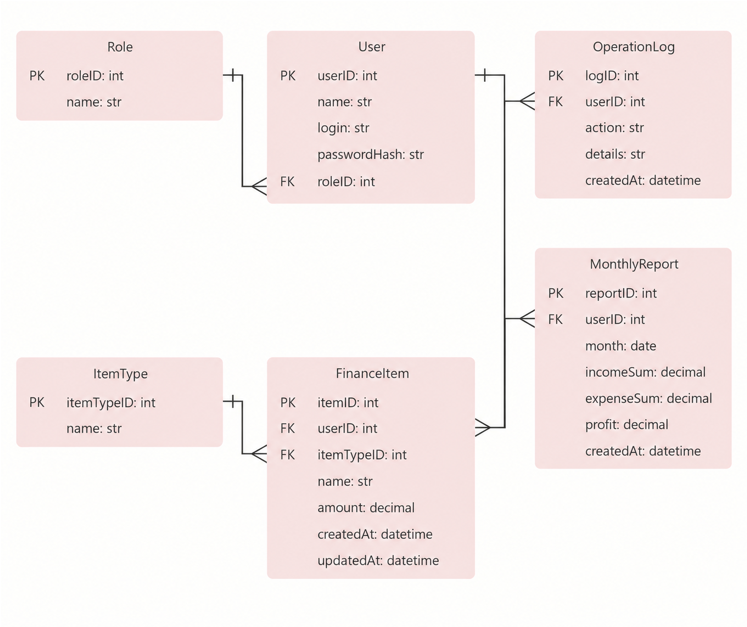

# MoneyOrgTrack

Система контроля доходов и расходов организации.

## 1. Постановка задачи

**Предметная область:** пункты доходов и расходов организации, суммы, даты, пользователи и их роли.

**Цели системы:**

- централизованно хранить данные о доходах и расходах;
- разграничивать доступ по ролям;
- рассчитывать доходы, расходы и прибыль за выбранный месяц;
- экспортировать данные в распространённые форматы.

**Пользователи (акторы):**

| Роль | Возможности |
| --- | --- |
| `admin` | Всё, что может руководитель, плюс управление пользователями |
| `manager` | Изменение типов и пунктов, отчёты, экспорт |
| `employee` | Только просмотр пунктов, отчётов и экспорт |

**Основные функции:** просмотр списка доходов и расходов, добавление/удаление пунктов, изменение сумм, расчёт отчёта за месяц, регистрация и авторизация, экспорт данных.

**Архитектура:** многослойная (UI → сервисы → репозитории → база данных). Используется только стандартная библиотека Python.

## 2. Структура проекта

```text
MoneyOrgTrack/
├── README.md
├── .gitignore
├── docs/
│   ├── ERD.png               # ER-диаграмма
│   └── UseCase.plantuml      # диаграмма вариантов использования
└── src/
    └── MoneyOrgTrack/
        ├── main.py           # точка входа
        ├── auth.py           # вход и регистрация в консоли
        ├── menu.py           # консольные меню
        ├── database/         # SQLite: подключение и schema.sql
        ├── models/           # dataclass-модели сущностей
        ├── repositories/     # SQL-запросы и CRUD
        └── services/         # бизнес-логика, экспорт
```

## 3. Запуск

```bash
python -m src.MoneyOrgTrack.main
```

При первом запуске создаётся `data/moneyorgtrack.db` с тестовыми записями.

### Демо-аккаунты

| Логин | Пароль | Роль |
| --- | --- | --- |
| `admin` | `admin123` | Администратор |
| `manager` | `manager123` | Руководитель |
| `employee` | `employee123` | Сотрудник |

Пароли хранятся в виде PBKDF2-HMAC-SHA256 с уникальной солью.

## 4. База данных

Таблицы соответствуют ER-диаграмме:

- `Role` — справочник ролей;
- `ItemType` — типы пунктов (`income` / `expense`);
- `User` — пользователи, ссылка на `Role`;
- `FinancialItem` — пункты доходов и расходов, ссылки на `User` и `ItemType`;
- `OperationLog` — журнал действий пользователей;
- `MonthlyReport` — сохранённые отчёты за месяц.

Связи: `Role 1—N User`, `User 1—N FinancialItem`, `ItemType 1—N FinancialItem`, `User 1—N OperationLog`, `User 1—N MonthlyReport`.

### ER-диаграмма



Диаграмма вариантов использования: [`docs/UseCase.plantuml`](docs/UseCase.plantuml).

## 5. Экспорт

Пункт меню «Экспорт данных» создаёт в каталоге `out/` четыре файла:

| Файл | Формат |
| --- | --- |
| `data.json` | JSON |
| `data.csv` | CSV (UTF-8 с BOM) |
| `data.xml` | XML `<operations><operation>…` |
| `data.yaml` | YAML-список `operations:` |
